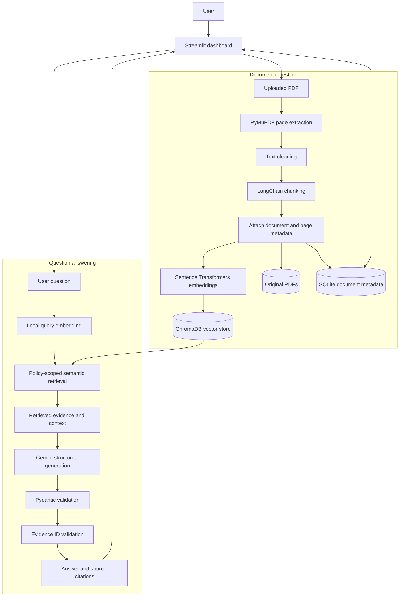
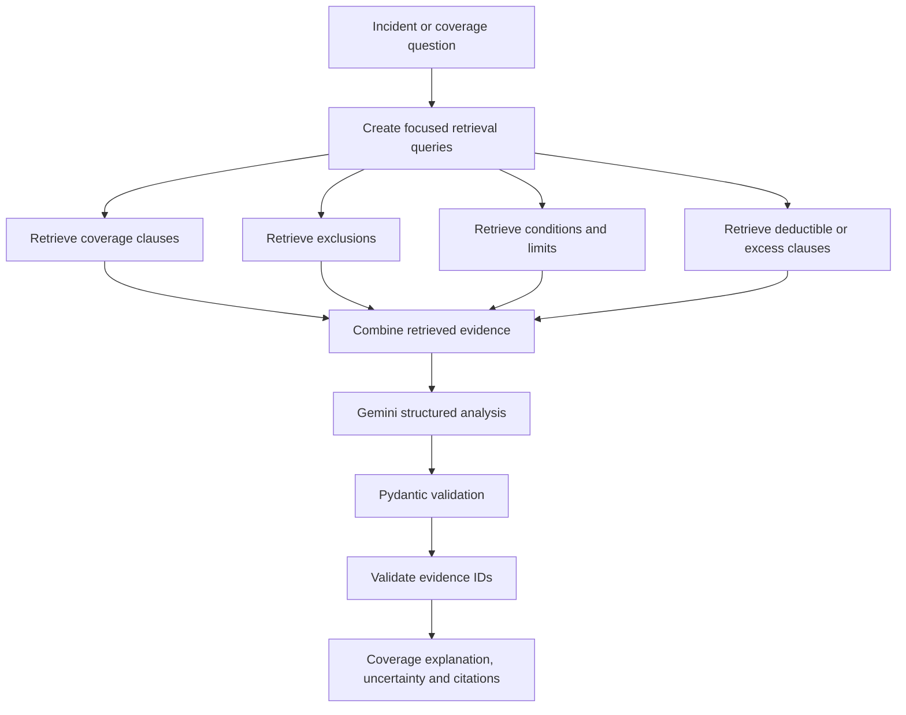

# PolicyLens

**PolicyLens** is an AI-powered motor insurance policy and claims assistant. It helps users explore the wording in uploaded insurance PDFs, understand potentially relevant coverage and exclusions, and identify claim documents mentioned in an insurer's procedures.

PolicyLens uses retrieval-augmented generation (RAG). Instead of asking a language model to answer from general knowledge, it searches the selected policy workspace, passes relevant passages to Gemini, and displays answers with references to the source PDF and page number.

> **Important:** PolicyLens explains information found in uploaded documents. It does not provide an insurance coverage decision, determine claim eligibility, guarantee claim approval, or replace advice from the insurer. A claim outcome depends on the complete policy contract, endorsements, facts, evidence and the insurer's assessment.

---

## Contents

- [What PolicyLens does](#what-policylens-does)
- [How it works](#how-it-works)
- [System architecture](#system-architecture)
- [Technology](#technology)
- [Project structure](#project-structure)
- [Requirements](#requirements)
- [Installation](#installation)
- [Configuration](#configuration)
- [Run the application](#run-the-application)
- [Using PolicyLens](#using-policylens)
- [Evaluation](#evaluation)
- [Data storage and privacy](#data-storage-and-privacy)
- [Current limitations](#current-limitations)
- [Troubleshooting](#troubleshooting)

## What PolicyLens does

PolicyLens provides a single workspace for reviewing motor insurance documents and asking questions about their contents.

### 1. PDF document management

- Upload one or more PDF documents.
- Identify each document as policy wording, policy schedule, add-on, claim guide or other.
- Organise documents into named policy workspaces.
- View the indexed documents and their page and chunk counts.
- Delete a document and its associated vector records.
- Detect duplicate PDFs within the same workspace.

### 2. Policy question answering

Ask questions in natural language, for example:

- What types of damage are covered?
- Is accidental damage covered?
- What exclusions apply to this benefit?
- What is the compulsory deductible?
- Does the schedule include roadside assistance?
- What does the policy say about theft claims?

Answers are generated from passages retrieved from the currently selected policy workspace. Relevant source passages are displayed with their document names and PDF page numbers.

### 3. Coverage and exclusion analysis

Describe an incident or coverage scenario. PolicyLens searches for potentially relevant:

- Coverage wording
- Exclusions
- Conditions and limitations
- Deductibles or excess amounts

The analysis presents these areas separately, identifies information that is not established by the retrieved documents, and avoids treating a coverage clause alone as proof that a claim will be accepted.

### 4. Claim document checklist

Describe the incident or request a general claim checklist. PolicyLens searches the uploaded claim procedure and policy documents for documents that the insurer names or requires. Each extracted item can be classified as required, conditional or not stated, with an explanation and supporting evidence where available.

The checklist is limited to the documents retrieved. It is not guaranteed to be exhaustive.

### 5. Conversation history

- Start a new conversation within a policy workspace.
- Continue a previous conversation.
- Keep separate conversation histories for different policy workspaces.
- Retain user and assistant messages, together with citation metadata, in SQLite.

### 6. Retrieval evaluation

The Evaluation tab can load the included synthetic policy PDFs and run a local retrieval benchmark. Separate scripts are available for retrieval evaluation and Gemini-based answer evaluation.

---

## How it works

PolicyLens has two main flows: **document ingestion** and **question answering**.

### Document ingestion

1. A user uploads a PDF and chooses its policy workspace and document type.
2. PyMuPDF extracts selectable text page by page.
3. Text is cleaned while preserving page boundaries.
4. LangChain's recursive text splitter creates overlapping chunks from each page.
5. Each chunk receives metadata such as document ID, source filename, policy workspace, document type, page number and chunk index.
6. Sentence Transformers converts the chunks into local vector embeddings.
7. ChromaDB stores the vectors, text and metadata in a persistent local collection.
8. SQLite stores document details used by the dashboard and document manager.

### Question answering

1. A user selects a policy workspace and submits a question.
2. PolicyLens creates a local embedding for the question.
3. ChromaDB searches for the most relevant chunks, restricted to the selected policy workspace.
4. The retrieved passages and relevant conversation context are sent to Gemini.
5. Gemini returns a structured response validated with Pydantic.
6. PolicyLens checks the returned evidence IDs against the chunks actually retrieved.
7. The application builds citations from stored chunk metadata, including the original filename and page number.
8. The answer, citations and available timing information are saved in SQLite and displayed in Streamlit.

The model does not create source filenames or page numbers. Citation details come from the metadata attached during PDF ingestion. Citation validation confirms that a cited evidence ID belongs to the current retrieval result; it does not independently prove that an interpretation is legally correct.

---

## System architecture

### End-to-end architecture



### Coverage analysis



### Main components

| Component | Responsibility |
|---|---|
| Streamlit | User interface, PDF upload, workspace selection, chat, analysis tabs and conversation history |
| PyMuPDF | Extract selectable text from each PDF page and preserve the source page number |
| Text cleaning | Normalize extracted text and repair common PDF line-wrap issues |
| LangChain text splitters | Split page text into overlapping chunks while retaining page-level metadata |
| Sentence Transformers | Generate local semantic embeddings for document chunks and user queries |
| ChromaDB | Persist embeddings, chunk text and metadata; retrieve relevant passages by similarity |
| Gemini API | Generate natural-language answers and structured coverage/checklist outputs from retrieved evidence |
| Pydantic | Validate the structure and fields returned by Gemini |
| Citation validator | Reject evidence IDs that were not present in the current retrieval result |
| SQLite | Store document metadata, policy workspaces, conversation sessions and messages |

---

## Technology

| Technology | Usage in PolicyLens |
|---|---|
| Python | Application and backend logic |
| Streamlit | Web interface |
| LangChain Text Splitters | Recursive text chunking |
| LangChain Google GenAI | Gemini model integration |
| Gemini API | Evidence-grounded response generation |
| Sentence Transformers | Local text embeddings (`all-MiniLM-L6-v2` by default) |
| ChromaDB | Persistent vector database |
| PyMuPDF | PDF text extraction |
| Pydantic | Structured response validation |
| SQLite | Document metadata and conversation persistence |

The embedding model runs locally after its model files have been downloaded. Gemini is used for answer generation and structured analysis.

---

## Project structure

```text
PolicyLens/
├── app.py                          # Streamlit application and dashboard
├── requirements.txt                # Python dependencies
├── .env.example                    # Environment configuration template
├── .gitignore                      # Excludes secrets and local user data
├── LICENSE
│
├── policylens/                     # Application backend
│   ├── __init__.py
│   ├── config.py                   # Paths and environment settings
│   ├── schemas.py                  # Pydantic response schemas
│   ├── database.py                 # SQLite data access
│   ├── pdf_ingestion.py            # PDF extraction and text cleaning
│   ├── chunking.py                 # Chunk creation and clause labels
│   ├── embeddings.py               # Sentence Transformers wrapper
│   ├── vector_store.py             # Persistent ChromaDB operations
│   ├── retrieval.py                 # Policy-scoped semantic retrieval
│   ├── llm.py                       # Gemini integration and structured calls
│   ├── citations.py                 # Evidence ID validation and citations
│   ├── ingestion.py                 # PDF processing and deletion workflow
│   ├── rag.py                       # Retrieval-augmented question answering
│   ├── coverage.py                  # Coverage and exclusion analysis
│   ├── checklist.py                 # Claim document checklist generation
│   └── evaluation.py                # Sample indexing and retrieval evaluation
│
├── sample_policies/                # Synthetic PDFs for local testing
├── evaluation/
│   ├── gold_questions.json         # Retrieval test questions and expected evidence
│   └── answer_questions.json       # Answer-level test questions
│
├── scripts/
│   ├── create_sample_pdfs.py       # Generate the synthetic sample PDFs
│   ├── run_retrieval_evaluation.py # Run retrieval benchmark
│   └── run_answer_evaluation.py    # Run Gemini answer evaluation
│
├── tests/                          # Unit tests
├── docs/
│   └── architecture.md             # Additional architecture notes
│
└── data/                            # Created locally; excluded from Git
    ├── uploads/                    # Original uploaded PDFs
    ├── chroma/                     # Persistent vector database
    └── policylens.sqlite3          # SQLite database
```

---

## Requirements

- Python **3.11 (64-bit)**
- A Gemini API key from [Google AI Studio](https://aistudio.google.com/apikey)
- Internet access for Gemini requests and the initial download of the embedding model
- A Windows, macOS or Linux environment

The dependency versions are specified in `requirements.txt`.

## Installation

### Windows (PowerShell)

Open PowerShell in the project root directory.

#### 1. Create and activate a virtual environment

```powershell
py -3.11 -m venv .venv
.\.venv\Scripts\Activate.ps1
```

If PowerShell prevents activation in the current terminal session, run:

```powershell
Set-ExecutionPolicy -Scope Process -ExecutionPolicy Bypass
.\.venv\Scripts\Activate.ps1
```

#### 2. Install dependencies

```powershell
python -m pip install --upgrade pip
pip install -r requirements.txt
```

### macOS or Linux

```bash
python3.11 -m venv .venv
source .venv/bin/activate
python -m pip install --upgrade pip
pip install -r requirements.txt
```

---

## Configuration

Create a local `.env` file from the example:

### Windows

```powershell
Copy-Item .env.example .env
notepad .env
```

### macOS or Linux

```bash
cp .env.example .env
nano .env
```

Set your Gemini API key and review the configuration values:

```dotenv
GOOGLE_API_KEY=your_gemini_api_key_here
GEMINI_MODEL=gemini-3.8-flash

EMBEDDING_MODEL=sentence-transformers/all-MiniLM-L6-v2

CHUNK_SIZE=900
CHUNK_OVERLAP=130
RETRIEVAL_TOP_K=6
MAX_UPLOAD_MB=25
```

Create or manage a Gemini API key at [Google AI Studio – API keys](https://aistudio.google.com/apikey).

| Variable | Description |
|---|---|
| `GOOGLE_API_KEY` | API key used to call Gemini |
| `GEMINI_MODEL` | Gemini model identifier |
| `EMBEDDING_MODEL` | Sentence Transformers model used for local embeddings |
| `CHUNK_SIZE` | Maximum text chunk size used during splitting |
| `CHUNK_OVERLAP` | Number of overlapping characters between adjacent chunks |
| `RETRIEVAL_TOP_K` | Default number of chunks retrieved for a question |
| `MAX_UPLOAD_MB` | Maximum size allowed for each uploaded PDF |

**Keep `.env` private.** It contains your API key and must not be committed to Git. The repository's `.gitignore` excludes it.

---

## Run the application

From the project root, with the virtual environment activated:

```powershell
streamlit run app.py
```

Open the local URL printed in the terminal. Streamlit normally uses:

```text
http://localhost:8501
```

To stop the application, press `Ctrl + C` in the terminal running Streamlit.

---

## Using PolicyLens

### 1. Create a policy workspace and upload documents

1. Open **Add policy PDFs** in the left sidebar.
2. Enter a workspace name, for example `My Motor Policy`.
3. Select the document type: policy wording, policy schedule, add-on, claim guide or other.
4. Select one or more PDF files.
5. Click **Process uploaded PDFs**.
6. Wait for indexing to complete. The document list displays the page count and number of indexed chunks.

A workspace should represent one policy or one clearly related set of documents. Keep different insurers' policies in separate workspaces. PolicyLens filters retrieval by the active workspace so that documents from unrelated workspaces are not intentionally mixed in a search.

### 2. Ask a policy question

1. Select the correct workspace under **Active policy**.
2. Open **Ask your policy**.
3. Enter a question in the chat box.
4. Review the answer and expand **Sources and supporting passages** to inspect the cited PDF pages.

Example questions:

- What damage is covered under Section I?
- What exclusions apply to accidental damage?
- What compulsory deductible is specified in the schedule?
- Does this policy include roadside assistance?
- What does the policy say about depreciation on replaced parts?

### 3. Analyse a coverage scenario

1. Open **Coverage & exclusions**.
2. Describe the incident or coverage question.
3. Select **Analyse policy evidence**.
4. Review potential coverage, relevant exclusions, conditions and limits, deductible/excess, missing information and source citations.

This analysis is an explanation of retrieved policy wording. It is not an approval or rejection of a claim.

### 4. Generate a claim checklist

1. Open **Claim checklist**.
2. Describe what happened, or leave the field blank for a general checklist.
3. Select **Generate checklist**.
4. Review each document, its stated purpose, whether it is required or conditional, and its supporting source passage.
5. Provide any additional information requested by the application.

The checklist reflects the uploaded and retrieved documents. The insurer may request additional information.

### 5. Manage documents and conversations

- Use the sidebar to switch between policy workspaces.
- Use **Delete document** to remove an uploaded PDF and its associated indexed chunks.
- Use **New conversation** to start a separate chat in the active workspace.
- Select a saved conversation to return to its message history.

---

## Evaluation

PolicyLens includes a small evaluation set based on the synthetic PDFs in `sample_policies/`.

### Retrieval evaluation

The retrieval evaluation measures whether expected policy phrases appear in the retrieved chunks. It includes answerable questions and selected questions for which the sample documents do not contain the expected evidence.

Run it from the project root:

```powershell
python scripts/run_retrieval_evaluation.py --top-k 6
```

The script indexes the sample PDFs if they are not already present, runs the benchmark and writes the report to:

```text
evaluation/latest_results.json
```

The Evaluation tab can also load the synthetic samples and display the retrieval results in the application.

### Answer-level evaluation

The answer-level evaluation calls Gemini for each configured question and then uses a separate Gemini evaluation call to estimate faithfulness and relevance. It also checks whether citations match the expected source documents and records answer latency.

Run it with:

```powershell
python scripts/run_answer_evaluation.py --limit 5
```

The report is written to:

```text
evaluation/answer_results.json
```

This evaluation requires a valid Gemini API key and uses additional model requests. LLM-based faithfulness and relevance scores are estimates, not ground-truth measurements. Review answers, source passages and citations manually when interpreting the report.

### Unit tests

Run the local tests with:

```powershell
python -m pytest -q
```

The tests cover PDF extraction and text cleaning, citation ID validation, and SQLite conversation persistence. They do not validate Gemini availability or guarantee the quality of model-generated policy interpretations.

---

## Data storage and privacy

PolicyLens stores application data locally in the `data/` directory:

| Path | Contents |
|---|---|
| `data/uploads/` | Original uploaded PDF files |
| `data/chroma/` | Persistent ChromaDB vector collection |
| `data/policylens.sqlite3` | Document metadata, workspaces, sessions and messages |

The `data/` directory is excluded from Git by `.gitignore`. It is created automatically when the application starts.

### Gemini data flow

PDFs and their indexed vectors are stored locally. However, when a user asks a question or requests an analysis, PolicyLens sends the question and selected retrieved text excerpts to the configured Gemini API to generate a response. Do not upload confidential policyholder information or sensitive personal documents unless you are authorised to do so and have reviewed the applicable provider terms and privacy requirements.

The `.env` file contains the Gemini API key. Keep it out of source control and do not share it in screenshots, logs or issue reports.

---

## Current limitations

- **Text-based PDFs only:** PDFs must contain selectable text. Scanned or image-only PDFs are not processed because OCR is not included.
- **No password-protected PDFs:** Remove PDF passwords before uploading.
- **No claim adjudication:** PolicyLens cannot confirm whether an insurer will accept or pay a claim.
- **No insurer integration:** The application does not submit claims, check claim status, retrieve live policy records or connect to insurer systems.
- **Clause labels are heuristic:** Clause categories such as coverage, exclusion, deductible and claim documents are assigned using keyword-based rules. They are supporting metadata, not authoritative classifications.
- **Page-level, chunk-based citations:** Citations identify the source file and PDF page and show the retrieved text. The application does not highlight exact text locations inside a PDF viewer.
- **Single-user local setup:** This version does not include user authentication, multi-user access control, encrypted document storage or organisation-level administration.
- **Model availability and latency:** Gemini responses depend on network connectivity and the availability and response time of the configured model. Temporary provider errors can interrupt generation even when local retrieval succeeds.

---

## Troubleshooting

### Gemini reports an invalid API key

- Confirm that `.env` is in the project root, next to `app.py`.
- Check that `GOOGLE_API_KEY` contains the key created in Google AI Studio.
- Do not include placeholder text or extra quotation marks.
- On Windows, an existing `GOOGLE_API_KEY` environment variable can take precedence over the value in `.env`. To remove it from the current PowerShell session before restarting Streamlit:

```powershell
Remove-Item Env:GOOGLE_API_KEY -ErrorAction SilentlyContinue
```

Restart Streamlit after changing the key.

### Gemini reports `503 UNAVAILABLE`

This indicates a temporary provider-side availability or capacity issue. It is not evidence that the PDF index is damaged. Wait briefly and retry the request. The uploaded PDFs, SQLite records and ChromaDB index remain stored locally.

### The first upload or first question is slow

The Sentence Transformers model may need to download its files and load into memory the first time it is used. Later calls reuse the locally cached model. Uploading a PDF also requires text extraction, chunking and embedding every chunk before indexing completes.

### No policy passages are found

- Confirm that the PDF was successfully indexed.
- Check that the correct policy workspace is selected.
- Make sure the PDF contains selectable text.
- Confirm that the uploaded documents contain the subject of the question.

### A PDF cannot be processed

The current version rejects invalid, password-protected and image-only PDFs. Use a readable text-based PDF with selectable text. OCR support is not currently included.

---

## License

See the [`LICENSE`](LICENSE) file for the license covering this repository. Third-party packages and externally sourced insurance documents may be subject to their own licences and terms. The PDFs in `sample_policies/` are synthetic demonstration documents and are not issued insurance contracts.
