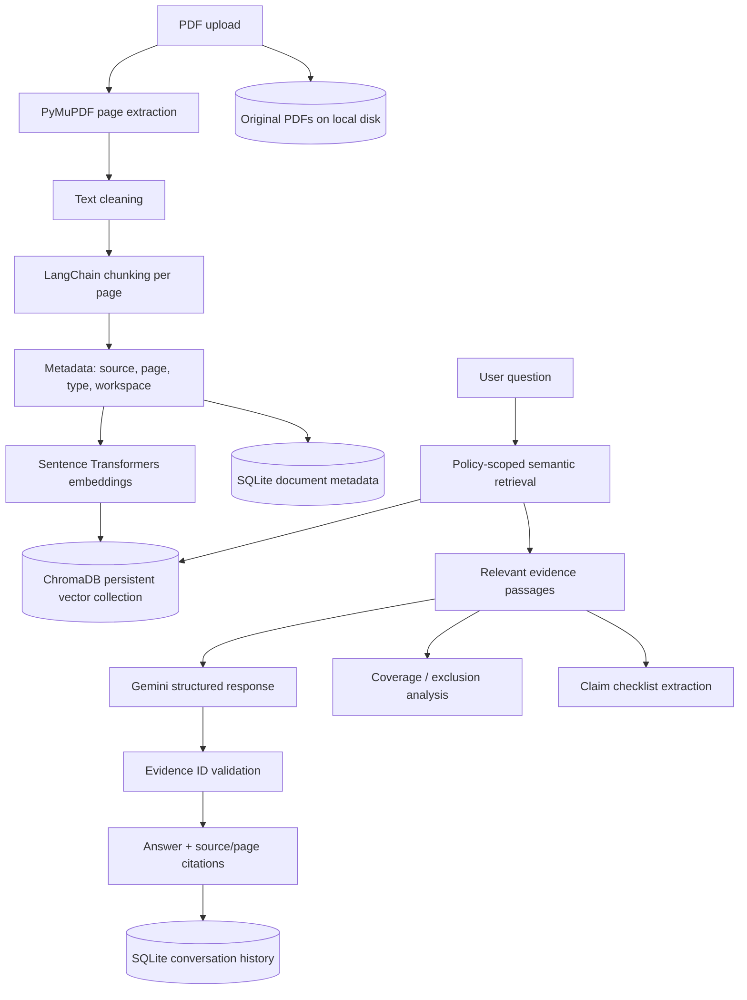

# PolicyLens — AI-Powered Insurance Policy & Claims Assistant

PolicyLens is a  Generative AI + Retrieval-Augmented Generation (RAG) project. It lets a user upload motor insurance policy wording, a policy schedule, add-on terms and claim instructions, then ask questions with source-document and page references.

> **Important:** The included policy PDFs are synthetic examples. PolicyLens is a demonstration tool, not an insurer, broker, legal adviser or claim adjudicator. It must not be used as the sole basis for a real insurance or financial decision.

## What the application does

- Accepts multiple PDF documents in a named policy workspace.
- Extracts selectable text page by page and retains the source filename and page number.
- Splits text using LangChain's `RecursiveCharacterTextSplitter` and adds policy/document metadata.
- Creates local sentence-transformer embeddings and stores vectors persistently in ChromaDB.
- Retrieves semantic matches scoped to the selected policy workspace.
- Uses Gemini to produce structured, evidence-grounded answers.
- Validates every model-returned evidence ID against the chunks retrieved for that answer before displaying a citation.
- Shows exact extracted passages with source document and page number.
- Separately analyses coverage, exclusions, conditions, limits and deductible/excess.
- Generates a claim-document checklist, with each item tied to supporting claim-guide evidence.
- Stores uploaded-document metadata and conversation history in SQLite.
- Includes synthetic PDF samples, retrieval evaluation questions, automated unit tests and an optional Gemini answer-evaluation script.

## Architecture



### Request lifecycle

1. **Ingestion:** The app validates the PDF, extracts text page-by-page, cleans line-wrap artefacts, chunks each page independently, embeds the chunks, writes vectors into ChromaDB, saves the original PDF locally, and stores metadata in SQLite.
2. **Retrieval:** The question is embedded locally and compared with vectors in the selected policy workspace. The top matching chunks are returned with their original source and page metadata.
3. **Generation:** Gemini receives the question, recent conversation context and retrieved policy passages. The system instructions explicitly tell the model to treat PDF text as reference data, ignore embedded instructions, avoid unsupported coverage claims and abstain when evidence is insufficient.
4. **Citation validation:** A citation is rendered only when the model refers to an evidence ID returned by the current retrieval request. The citation's filename, page number and passage are read from the retrieved chunk metadata—not invented by the model.
5. **Specialized analysis:** Coverage analysis searches separately for coverage, exclusion, condition and deductible evidence. The checklist module searches claim guides and asks Gemini to classify only documents supported by the retrieved text.

## Technology choices

| Technology | Role in PolicyLens |
|---|---|
| Python 3.11 | Application and service code; Python 3.11 is the recommended environment for the selected integrations. |
| Streamlit | Local web dashboard, upload controls, chat UI, tabs and checklist interaction. |
| LangChain Text Splitters | Recursive, overlapping chunks that preserve policy-page metadata. |
| LangChain Google GenAI | Gemini integration and structured Pydantic output. |
| Gemini API | Natural-language answers, coverage analysis and claim checklist extraction. |
| Sentence Transformers | Local semantic embeddings using `all-MiniLM-L6-v2`; no embedding API call is needed. |
| ChromaDB | Persistent local vector database for chunk embeddings and metadata. |
| PyMuPDF | Page-aware extraction of selectable text from PDF files. |
| Pydantic | Validates structured responses returned by Gemini. |
| SQLite | Stores document metadata, policy workspaces, sessions and chat messages. |

## Project structure

```text
PolicyLens/
├── app.py                         # Streamlit dashboard
├── requirements.txt               # Pinned / bounded dependencies
├── .env.example                   # Environment-variable template
├── .gitignore
├── README.md
├── docs/
│   └── architecture.md
├── policylens/
│   ├── config.py                  # Paths and environment settings
│   ├── schemas.py                 # Pydantic response models
│   ├── database.py                # SQLite repositories
│   ├── pdf_ingestion.py           # PDF extraction and cleaning
│   ├── chunking.py                # LangChain chunks and clause labels
│   ├── embeddings.py               # Local Sentence Transformer wrapper
│   ├── vector_store.py            # Persistent Chroma collection
│   ├── retrieval.py               # Policy-scoped semantic retrieval
│   ├── llm.py                     # Gemini structured-output integration
│   ├── citations.py               # Evidence ID validation and citations
│   ├── ingestion.py               # End-to-end PDF ingestion/deletion
│   ├── rag.py                     # Ordinary RAG question answering
│   ├── coverage.py                # Coverage/exclusion analysis
│   ├── checklist.py               # Claim-document checklist generation
│   └── evaluation.py              # Retrieval benchmark and sample indexing
├── sample_policies/               # Synthetic policy PDFs for safe testing
├── evaluation/
│   ├── gold_questions.json        # Retrieval test cases
│   ├── answer_questions.json      # Answer-level test cases
│   └── latest_results.json        # Generated by evaluator (not committed)
├── scripts/
│   ├── create_sample_pdfs.py
│   ├── run_retrieval_evaluation.py
│   └── run_answer_evaluation.py
├── tests/                         # Local unit tests
└── data/                          # Created locally; ignored by Git
    ├── uploads/                   # Original uploaded PDFs
    ├── chroma/                    # Chroma vector database files
    └── policylens.sqlite3         # SQLite data store
```

## Windows setup (PowerShell)

### 1. Install Python

Install **Python 3.11 (64-bit)** and make sure the Python launcher `py` is available in PowerShell.

### 2. Open the project folder

Extract the ZIP, open PowerShell in the extracted `PolicyLens` folder, and run:

```powershell
py -3.11 -m venv .venv
.\.venv\Scripts\Activate.ps1
python -m pip install --upgrade pip
pip install -r requirements.txt
```

If PowerShell blocks virtual-environment activation, run this once in the current PowerShell window:

```powershell
Set-ExecutionPolicy -Scope Process -ExecutionPolicy Bypass
.\.venv\Scripts\Activate.ps1
```

### 3. Configure Gemini

```powershell
Copy-Item .env.example .env
notepad .env
```

Create a Gemini API key in [Google AI Studio](https://aistudio.google.com/app/apikey), then set it in `.env`:

```dotenv
GOOGLE_API_KEY=put_your_real_key_here
GEMINI_MODEL=gemini-3.8-flash
EMBEDDING_MODEL=sentence-transformers/all-MiniLM-L6-v2
```

Do not commit `.env`, share your key, or paste it into source code. The local embedding model is downloaded from its model repository on first use; allow the first ingestion/evaluation run to finish while it is cached.

### 4. Run the app

```powershell
streamlit run app.py
```

Streamlit will print a local URL (normally `http://localhost:8501`). Open that URL in your browser.

### 5. Try the included sample policies

Open the **Evaluation** tab and click **Load synthetic sample policies and run evaluation**. This indexes the included sample policy wording, schedule and claim guide into a workspace named `PolicyLens Sample Motor Policy` and runs retrieval evaluation.

Then choose that workspace in the left sidebar and try:

- Is accidental collision damage covered?
- What compulsory deductible applies to an own-damage claim?
- Does the schedule include roadside assistance and towing?
- What extra documents are needed for a theft claim?
- Does my policy pay for a rental car while mine is repaired? (The sample documents do not state this benefit.)

## Evaluation

### Retrieval benchmark (no Gemini API call required after indexing)

```powershell
python scripts/run_retrieval_evaluation.py --top-k 6
```

This calculates mean Precision@k and Recall@k using manually selected phrases from the synthetic policy PDFs. It also includes absent-topic cases. The report is saved to `evaluation/latest_results.json`.

### Answer-level benchmark (requires Gemini API key)

```powershell
python scripts/run_answer_evaluation.py --limit 5
```

This measures response latency, validates whether citations point to the expected source document for each test case, and obtains approximate faithfulness and relevance scores from a separate Gemini-as-judge call. The report is saved to `evaluation/answer_results.json`.

**Evaluation caveat:** LLM-as-judge scores are not ground truth. Review the prompt, cited text and answer manually, and report the rubric and sample size if using the results in a portfolio or research context. The retrieval benchmark is a small synthetic test set, not an industry benchmark.

### Unit tests

```powershell
python -m pytest -q
```

## Data and privacy notes

- Uploaded PDFs, the SQLite database and Chroma index are stored locally under `data/`.
- The app sends the user's question and retrieved text excerpts to the Gemini API for generation. Do not upload sensitive real customer documents unless you have permission and have reviewed the relevant provider terms and your organisation's privacy requirements.
- The API key is read from `.env`; it is not included in prompts or stored in SQLite.
- Use synthetic or public sample documents while developing.
- This version supports PDFs with selectable text. Scanned PDFs need OCR before ingestion; OCR is intentionally not bundled into this starter build.
- Uploaded PDFs are limited to the configured `MAX_UPLOAD_MB` per file. Increase the limit only after considering memory and storage.

## Known limitations and future improvements

1. **No OCR:** scanned/image-only documents are rejected with a clear message.
2. **Heuristic clause tags:** clause labels are keyword-based metadata to assist analysis; the final answer still needs retrieved evidence and does not treat tags as definitive legal classification.
3. **Semantic retrieval only:** this version uses cosine similarity over local embeddings. A production system may add hybrid BM25/vector retrieval, reranking, parent-child retrieval and query expansion.
4. **Chunk-level citations:** references are page-accurate and show the retrieved chunk, but do not include character-level highlights in the original PDF viewer.
5. **No user accounts or encryption:** it is a local single-user portfolio app. A multi-user deployment needs authentication, per-user storage isolation, encryption, access controls, audit logging and retention/deletion policies.
6. **No insurer integration:** claim status, live repair network, premiums and claim submission are not connected.
7. **Policy interpretation is not adjudication:** the final claim outcome depends on the complete issued contract, endorsements, evidence, survey and insurer decision.

## GitHub checklist

Before publishing your own repository:

- Keep `.env`, `data/`, user-uploaded policy PDFs and API keys out of Git.
- Commit only the synthetic sample PDFs and source code that you are permitted to share.
- Add screenshots of the dashboard after running it locally.
- Include your own evaluation outputs and explain the limitations honestly.
- Replace any personally identifying text in screenshots or local sample data.

## License

The PolicyLens source code is provided under the MIT License. The synthetic PDF samples are original demonstration content included for this project. PyMuPDF is distributed under AGPL-3.0 or a commercial license; review licensing before distributing a proprietary application that depends on it.
# policylens-ai

